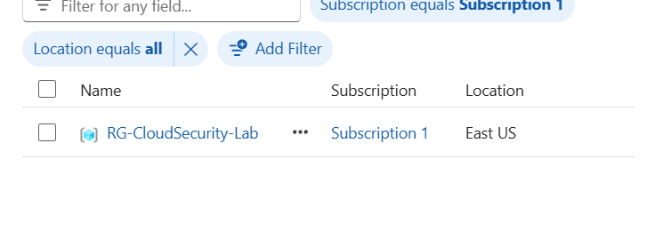
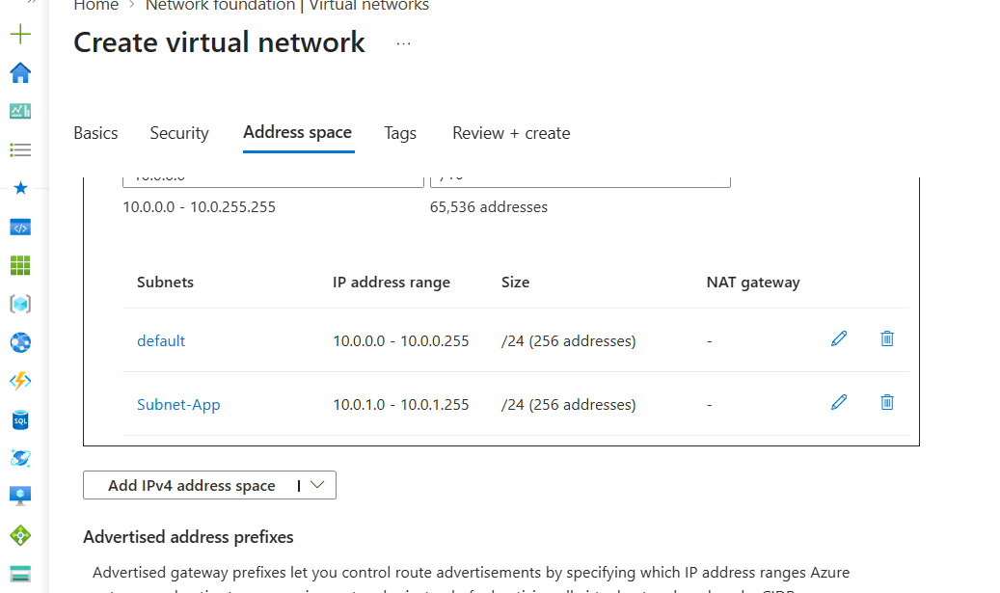
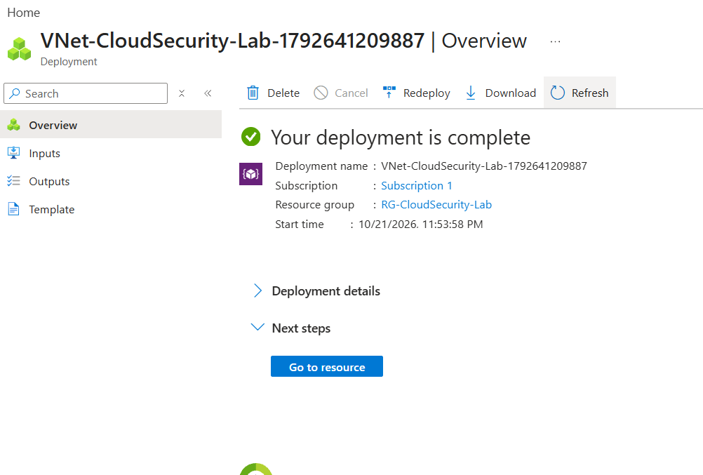

# Azure Cloud Security Journey ☁️🛡️

**Hands-on portfolio | Azure networking, identity, security engineering, and incident response**

This repository documents my progression toward cloud security engineering through practical Microsoft Azure labs. Each lab records the objective, architecture, configuration, security rationale, validation, and lessons learned.

> **Lab environment:** Personal Azure subscription using a dedicated training resource group. Screenshots are from the training lab; visible account identifiers have been minimized. Review every image before publishing.

## Learning goals

- Build and secure Azure infrastructure using least-privilege and defense-in-depth principles.
- Understand virtual networking, subnets, Network Security Groups (NSGs), and traffic flow.
- Practice identity security, monitoring, threat detection, and incident response.
- Validate configurations rather than assuming a successful deployment means a secure deployment.
- Develop repeatable documentation and eventually automate deployments.

## Progress tracker

| Mission | Lab | Status | Evidence |
|---|---|---|---|
| 001 | Azure subscription, resource group, VNet and subnet foundations | ✅ Completed | [Mission 001](#mission-001--azure-network-foundations) |
| 002 | Network Security Group and custom inbound/outbound rules | ✅ Completed | [Mission 002](#mission-002--network-security-group-configuration) |
| 003 | NSG rule priority and configuration audit | ✅ Configuration audit completed | [Mission 003](#mission-003--security-control-validation) |
| 004 | Assess overly permissive RDP rules | ⏳ Next | [Next steps](#next-steps) |

## Lab architecture

```text
Microsoft Entra tenant: Rosetta Stone (personal lab)
└── Azure subscription: Subscription 1
    └── Resource group: RG-CloudSecurity-Lab (East US)
        ├── Virtual network: VNet-CloudSecurity-Lab (10.0.0.0/16)
        │   ├── default subnet (10.0.0.0/24)
        │   └── Subnet-App (10.0.1.0/24)
        │       └── Associated NSG: NSG-App-Lab
        └── Network security group: NSG-App-Lab
            ├── Inbound: Deny-Default-to-App (priority 100)
            └── Outbound: Deny-App-to-Default (priority 100)
```

**Important:** Subnets are address boundaries, not automatic isolation boundaries. The NSG enforces the intended network filtering when correctly associated with the subnet. No VMs or application workloads were deployed in these exercises.

## Mission 001 — Azure network foundations

**Objective:** Establish a personal Azure lab and deploy an organized virtual network.

### Tasks completed

1. Confirmed an active Azure subscription and Owner role.
2. Created resource group `RG-CloudSecurity-Lab` in **East US**.
3. Deployed virtual network `VNet-CloudSecurity-Lab` with address space `10.0.0.0/16`.
4. Configured two non-overlapping subnets:
   - `default`: `10.0.0.0/24`
   - `Subnet-App`: `10.0.1.0/24`
5. Confirmed Azure reported **deployment complete**.

### What I learned

- **Microsoft Entra tenant:** Identity and directory boundary.
- **Azure subscription:** Resource management and billing scope.
- **Resource group:** Logical container for related Azure resources.
- **VNet:** Private address space for Azure network connectivity.
- **Subnet:** A portion of a VNet's address space; for example, a `/24` contains 256 IPv4 addresses, of which Azure reserves five.

### Evidence

**Resource group created**



**VNet and two subnets configured**



**Successful deployment**



## Mission 002 — Network Security Group configuration

**Objective:** Configure a subnet-level NSG to restrict new connections between the default and application subnets.

### Tasks completed

1. Created `NSG-App-Lab` in the lab resource group.
2. Reviewed default inbound NSG rules, including `AllowVnetInBound`, `AllowAzureLoadBalancerInBound`, and `DenyAllInBound`.
3. Added a custom **inbound deny** rule.
4. Added a custom **outbound deny** rule.
5. Associated `NSG-App-Lab` with `Subnet-App` (`10.0.1.0/24`).

### Custom rule configuration

| Direction | Rule name | Source | Destination | Ports / protocol | Action | Priority |
|---|---|---|---|---|---|---|
| Inbound | `Deny-Default-to-App` | `10.0.0.0/24` | `10.0.1.0/24` | Any | Deny | 100 |
| Outbound | `Deny-App-to-Default` | `10.0.1.0/24` | `10.0.0.0/24` | Any | Deny | 100 |

### Security rationale

Azure's default NSG rules generally allow traffic within the VNet. These custom rules are intended to prevent **new connections in either direction** between the two lab subnets when the NSG is applied to `Subnet-App`.

NSGs are **stateful**, meaning return traffic for permitted connections is handled differently from a new connection initiated in the reverse direction. Lower numeric priorities are evaluated first; a matching rule at priority `100` takes precedence over the default allow rule at priority `65000`.

### Evidence

**Default inbound rules reviewed**


**Inbound deny rule — source and destination**


**Outbound deny rule — source and destination**


**Outbound deny rule — action, priority, and name**


**NSG subnet association**


## Mission 003 — Security control validation

**Objective:** Audit the NSG configuration and distinguish configuration review from live traffic testing.

### Audit checklist

- [x] Reviewed custom inbound deny rule and priority.
- [x] Reviewed custom outbound deny rule and priority.
- [x] Confirmed `Subnet-App` appears in the NSG's associated subnets.
- [x] Explained why priority `100` takes precedence over default priority `65000`.
- [ ] Perform an actual traffic-flow test when a suitable, cost-approved test environment exists.

### Validation limitations

This was a **configuration audit**, not a packet-level connectivity test. No virtual machines or network interfaces were deployed for traffic testing, so live enforcement was not empirically verified. Future validation can include Network Watcher diagnostics or controlled test endpoints after reviewing costs.

## Troubleshooting and lessons learned

**Issue:** The Azure portal initially showed a welcome screen and no subscriptions in the selected directory.

**Investigation:** Checked the active Microsoft Entra directory and the Azure Subscriptions page. Later confirmed that `Subscription 1` was visible and active.

**Lesson:** Being able to sign in to an Entra tenant is not the same as having an Azure subscription. Always verify the subscription, tenant, role, and billing scope before deploying resources.

## Next steps

### Mission 004 — Identify risky NSG rules

- [ ] Review a hypothetical inbound rule allowing RDP (`TCP/3389`) from `Any`.
- [ ] Assess whether a reachable path and listening service create actual exposure.
- [ ] Recommend least-privilege alternatives, such as tightly scoped administration or private access.
- [ ] Document the finding, risk, remediation, and validation plan.

### Future labs

- [ ] Azure RBAC and least privilege
- [ ] Microsoft Entra ID, MFA, and Conditional Access
- [ ] Azure Policy and governance
- [ ] Defender for Cloud security posture
- [ ] Log Analytics and Microsoft Sentinel fundamentals
- [ ] Infrastructure as Code (Bicep or Terraform)
- [ ] Incident response and detection engineering in Azure

## Lab journal template

Copy this section for each new lab:

```markdown
### Mission XXX — [Lab title]
**Date:** YYYY-MM-DD  
**Objective:** [What I wanted to achieve]

**Architecture / resources:**
- [Resource name and purpose]

**Steps performed:**
1. [Action]
2. [Action]

**Security reasoning:**
- [Why the control matters]

**Validation:**
- [What I verified and how]
- [What I have not yet tested]

**Challenges and fixes:**
- [Problem → investigation → resolution]

**Evidence:**
- [Sanitized screenshot or diagram]

**What I learned:**
- [Key takeaways]

**Next action:** [Next exercise]
```

## Repository organization

```text
azure-cloud-security-journey/
├── README.md
├── screenshots/
│   ├── mission-001/
│   ├── mission-002/
│   └── mission-003/ (future evidence)
└── labs/
    └── README.md
```

## Security and cost notes

- Do not commit passwords, API keys, access tokens, connection strings, or tenant/subscription identifiers.
- Crop or redact personal email addresses, directory IDs, subscription IDs, correlation IDs, and other sensitive metadata from screenshots.
- Check Azure pricing before deploying VMs, Bastion, Firewall, NAT Gateway, logging, or other potentially billable services.
- Remove unused lab resources after testing.

---

*Documenting the journey from IT support to cloud security engineering—one verified lab at a time.*
